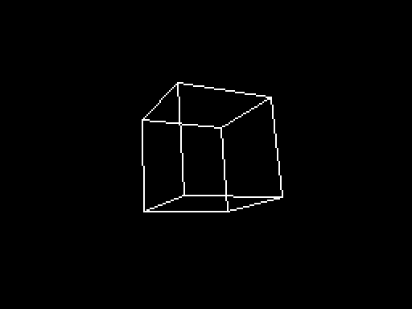

# fast3d

Fast 3D for the Z80: signed multiplication, a rotation matrix from three
angles, rotating and projecting vertices, drawing lines clipped to a
window, and a world of objects seen from a camera, with what is out of view
culled before any of its vertices is touched and edges that pass behind
the eye cut at a near plane. With them comes a demo on the
128K, a flight through forty turning cubes and icosahedra. The same
routines for the BBC Micro's 6502, with the same arithmetic (objects and the
camera not yet), are in
[vs-code-bbc/examples/fast3d](https://github.com/jonsole/vs-code-bbc/tree/master/examples/fast3d).

`INCLUDE "fast3d.s"` anywhere in an sjasmplus program. It aligns its own
tables (2K of them, from a 512-byte boundary). It never touches IY, so the
ROM's interrupt routine can keep running.

Three defines change what it does, all off unless the program defines them
(`-DNAME=1` to sjasmplus, or an `EQU` before the `INCLUDE`):

- `CULL_SKIP`: the cull says how far out of view an object was, so that it
  can be left alone until it could have come into view (see
  [Skipping the cull](#how-they-are-quick)).
- `WORLD_WRAP`: the world wraps. World positions are 16-bit, a world
  65,536 units square; without the define, an object whose distance from
  the camera will not fit 16 bits on some axis is culled, as out of view
  across the world. With it, that distance is taken modulo 65,536 on each
  axis, -32,768..32,767, so an object just across an edge or a corner of
  the world is seen from the other side, exactly as the same scene moved
  away from the edges would be; and the camera crossing an edge moves a
  step, not a jump that voids `CULL_SKIP`'s margins. Skipping stays right:
  an object is tested again before the camera could have travelled its
  room, so its distance never comes near 32,768 and wraps to the other
  side while it is skipped. It costs nothing: two overflow tests (`JP PE`)
  are left out, one in `cull_object` and one in `cull_skip_bounds`.
  Without it, the code is the same, byte for byte.
- `FACE_EYE`: `facing_edges` judges each face against the eye carried into
  the model's space, rather than by its projection (see
  [Back faces](#how-they-are-quick)): dearer an object, cheaper a face, a
  face behind the eye judged too, and misjudged far less often.

## The numbers

| What | Form |
|---|---|
| An angle | a byte, 256 to the turn |
| A vertex | three signed bytes, -128..127 |
| A matrix entry | a signed byte, -127..127, with 127 standing for 1.0 |
| A rotated coordinate | the exact 16-bit sum `m0*x + m1*y + m2*z`: 128 times the rotated coordinate (times 127/128) |
| A projected coordinate | `rot / Z`, with `Z = (rot_z + zoff) >> 8` |

With `zoff = 128 * d`, the projection is `256 * x / (z + d)`: the eye is `d`
units from the object's centre and 256 units from the screen. `Z` must stay
within 1..255, which keeps the object in front of the eye: with the object
inside a sphere of radius `r`, choose `d` between `r + 2` and `512 - r`.

[model.py](model.py) defines every result exactly, and
[check.py](check.py) holds the Z80 to it.

## The routines

T-states were measured in SkoolKit's simulator on uncontended memory; see
[Checking](#checking).

| Routine | In | Out | T-states |
|---|---|---|---|
| `mul8s` | B, C signed | HL = B * C | 154 |
| `make_matrix` | `angle_x`, `angle_y`, `angle_z` | `matrix` (9 bytes, row by row), and rotate's code | 3,982 |
| `compute_matrix`, `install_matrix` | the same, in two: the entries, then HL -> 9 entries into rotate | | 2,932, 1,013 |
| `rotate` | HL -> vertex | `rot_x`, `rot_y`, `rot_z` | 1,241 |
| `project` | `rot_*`, `zoff` | B = x, C = y (256 x 192, y down), or carry if off the screen | ~860 |
| `divide` | HL signed, C = 1..255 | HL = HL / C, or carry if it will not fit a byte | 333..453 |
| `transform` | HL -> vertices, DE -> points, B = count | x, y for each, y = $FF if off the screen | ~2,370 a vertex |
| `draw_line` | (B, C) to (D, E); `screen_high` $00 or $80 | the pixels, on $4000 or $C000 | ~60 a pixel along x, ~53 along y; ~270 to start |
| `clear_box` | B rows from row C, E bytes from column D | blank | ~11 a byte, plus ~75 a row |
| `project_wide` | `rot_*`, `zoff` | HL = x, DE = y, 16-bit, on the screen or off it; carry if Z is 0 | ~1,400 (70 when Z is 0) |
| `divide_wide` | HL signed, C = 1..255 | HL = HL / C, held to ±16,383 | 418..1,107 |
| `transform_wide` | as `transform` | x, y as 16-bit words; x = $8000 if at or behind the eye | |
| `set_window` | B, C = left, top; D, E = right, bottom | lines clip to that, inclusive | |
| `clip_line` | `clip_x0`, `clip_y0`, `clip_x1`, `clip_y1`, 16-bit | B, C, D, E for `draw_line`, or carry if none of it is in the window | 537 inside; ~1,400 outside; ~3,550 cut at one end; ~8,950 at both |
| `crossing_x`, `crossing_y` | DE = the edge; the line's ends | HL = where the line crosses it | ~2,240 (1,221..3,142) |
| `set_camera` | `camera_x`, `_y`, `_z`, `camera_angles` | the camera's matrix, its transpose in rotate | 9,399 a frame |
| `cull_object` | IX -> an object | carry if out of view; else `view_t`, its centre in camera space | 298 out of the box; ~3,240 out roughly; ~8,190 in view (with `CULL_SKIP`; ~1,200 less an object culled without) |
| `object_matrix` | IX -> an object in view | `view_m` = Rc^T Ro | ~8,330 |
| `transform_object` | IX; D = the points' page, E = the first vertex's place on it | its vertices to 16-bit screen points, at any distance, in the page's four tables of 64 bytes: x low, x high, y low, y high; x = $8000 if behind the near plane; and `view_edges`, `view_edge_count`, the model's edges | ~2,330 a vertex (~2,830 without mirrors) |
| `facing_edges` | IX, after `transform_object`; HL = its points (H the page, L the first); DE -> room for the model's edges | `view_edges`, `view_edge_count` (and A): the edges with a face either side that looks towards the eye, as pairs of vertices at DE; DE past them. A model with no faces keeps them all | ~1,500 a face, ~200 an edge; 187 with no faces. With `FACE_EYE`, ~5,600 an object and ~850 a face |
| `cut_edges` | IX, straight after `transform_object` (or `facing_edges`), and `view_edges`; HL = its points (H the page, L the first); DE -> room for the lines | each edge crossing the near plane, from its front end to where it crosses, as four words for `clip_line`; DE past them, A = how many | 45 with nothing behind the plane; ~7,000 a line cut |
| `draw_line_clipped` | as `clip_line` | `clip_line`, then `draw_line` | |

### How they are quick

- **Multiplying by quarter squares.** `a*b = f(a+b) - f(a-b)`, where
  `f(n) = floor(n*n/4)` comes from a 1K table. `mul8s` biases both bytes by
  128 so that the 9-bit sum's top bit lands in the carry, and `RL H` turns the
  carry into the table's page.
- **The matrix is written into the code.** For a frame's rotations, each
  matrix entry `m` is fixed, so `make_matrix` writes `SQ_CENTRE - 128 + m` and
  `SQ_CENTRE - 128 - m` straight into `rotate`'s `LD HL,nn` instructions. A
  product is then `ADD HL,DE` (DE is the vertex coordinate + 128) and a 16-bit
  read, twice. Nine of those make the 1,241 T-states.
- **No multiplications in the matrix.** Every entry of `Rz Ry Rx` is a
  product of sines and cosines. Each product is a sum of sines of sums of the
  angles (`cos A cos B = (cos(A-B) + cos(A+B)) / 2`, and its relatives). So an
  entry is at most eight table lookups, all of them additions: a minus sign is
  half a turn more, and a cosine a quarter turn more. The table holds
  `2032 sin(a)`. An entry is rounded once, at the end, and the scale was chosen
  so that no entry can round past 127. Across all angles the entries are
  within 0.55 of 127 times the true value.
- **Clipping only where it is needed.** `clip_line` is Cohen-Sutherland:
  each end gets a code saying which of the window's edges it is beyond, so
  a line wholly inside, or wholly beyond one edge, is settled in a few
  hundred T-states. Only a line that crosses an edge pays for a crossing,
  found by a binary chop: `crossing_x` for a left or right edge,
  `crossing_y` for a top or bottom. From one end, a step toward the other is
  halved again and again, and taken whenever the line stays short of the
  edge. Each halving is one bit of how far along the line the edge is (a
  division step) and adds that much of the other coordinate (a
  multiplication step), all in registers, and it stops once the step is
  under half a pixel: about 12 halvings. The numbers start as 24 bits, but
  after all but the last nine halvings they fit 16, and those nine run at
  about 100 T-states each rather than 170. A crossing takes about 2,240
  T-states, some 40% quicker than the 16 x 16 multiply and 32 / 16 divide
  it replaced, and slightly less exact: a clipped end is within 0.75 of a
  pixel of the true line (0.21 on average), where the exact sum gave half a
  pixel. Every crossing is worked out from the line's own ends, never from
  an end already moved. A moved end has been rounded, and on a shallow line
  the slope would multiply that rounding.
  `project_wide` divides the quick way whenever the quotient fits a byte,
  which it does for anything on the screen or near it.
- **Objects for the price of rotates.** An object at P, turned by Ro, seen
  from a camera at C turned by Rc, has its vertex v at
  `Rc^T (P - C) + (Rc^T Ro) v` in camera space. With `Rc^T` installed in
  `rotate`, both come from rotations of signed bytes. T is two rotates, of
  P - C's high bytes and of its low bytes less 128, with the 128s put back
  by a constant `set_camera` works out: exact in 24 bits. M is three
  rotates, of the columns of Ro. A model's vertices are shared by its faces,
  so each is transformed once, and each edge is drawn once.
- **Mirrored vertices for nothing.** `M (-v)` is exactly `-M v`, so where a
  model has a vertex and its mirror, as every vertex of a cube or an
  icosahedron does, `transform_object` rotates the first and has the second
  as `T - M v`. `build.py` puts such pairs first and says how many there
  are (`MODEL_PAIRS`), and half the rotates go.
- **The matrix installed unrolled.** A picture installs a matrix in
  `rotate` ten times or so: the camera's, and each object's. Each of
  `install_matrix`'s eighteen operands is written by its own `LD (nn),HL`,
  1,013 T-states in all, where a loop through a list of addresses took 2,456.
- **Culling in three steps, each quicker than the next.** An object is left
  out when its bounding sphere is wholly nearer than NEAR, farther than FAR,
  or beyond one of the planes `|x| = z / 2`, `|y| = z / 2`: a 90-degree view,
  as wide as the screen and a little taller, so that the lines clip whatever
  it lets through. First, an object more than 10,400 units from the camera
  on any axis is out, for 367 T-states. Then a rough T from P - C's high
  bytes alone, a row at a time: depth first, so that an object behind the
  eye is out after one row (from 1,758 T-states), then x, then y, each
  tested with the sphere enlarged by the most the low bytes could add.
  Of what reaches this step out of view, 72% goes here, for about 2,290. Only
  what is left, near a plane or in view, gets the exact T and the exact
  tests. The answer is always the exact test's.
- **Skipping the cull.** With `CULL_SKIP` defined, an object the cull
  leaves out is not tested again until it could have come into view. The
  cull says how far past a plane the object was, its margin, and T, the
  object's centre in camera space, can only move so far in a picture:
  `T' - T = (M' - M)(P - C) + M'(C - C')` exactly, M the camera's matrix,
  so on any axis by at most `E D + 127 m`, with E the largest row sum of
  the change in M, D the object's largest distance on an axis and m the
  camera's move. That is arithmetic on the matrices as they are, so it
  holds whatever the camera does -- jump, spin, stand still -- and nothing
  is assumed about its speed. Each picture `cull_skip_bounds` measures the
  camera's change and tabulates the bound for each size D is held as (a
  two-bit mantissa and a power of two, chosen with a quarter's room above
  D, and an odometer limit for when the camera could have travelled that
  room); the program cuts every skipping object's margin by its bound and
  tests it again when nothing is left. In the demo's flight 25 of the 40
  objects are skipped a picture, for 260 T-states each instead of 2,000
  or more. model.py has the reasoning, and `check.py` holds the Z80 to it
  under a camera that jumps and swings. Nothing of this changes what is
  drawn.
- **Any distance.** Before dividing, `transform_object` shifts each vertex's
  camera-space position right by just enough to bring its depth into a
  byte, so the quick divide works out to the far plane (8,191 units) with
  the depth to 8 bits. Each coordinate is made in registers -- z first,
  since the shift and the divisor come from it -- shifted there, and
  handed straight to the divide; the loop keeps its vertex, count and the
  point it writes in the alternate registers, so nothing goes through
  memory that need not.
- **Cutting at the near plane, with no divide.** A vertex nearer than the
  near plane (8.06 units: c_z under 1,024, where c is 127 times world units)
  is left unprojected, and `cut_edges` cuts each edge running from it to
  a vertex in front, in camera space, before projecting; the part in front
  is drawn, and an edge wholly behind the plane is left out. The plane sits
  where Z is 4, so a point on it lands c_x / 4, c_y / 4 from the centre: a
  shift. Seen from above, with x and z both in units of c / 4 -- pixels
  across, at the plane -- the cut is t = (256 - a_z) / (b_z - a_z) of the
  way along the edge, from its two ends taken back into camera space
  (rotated again, plus T). `cut_crossing` works t out once, to 16 bits, by
  a restoring division written out a bit at a time, all in 16 bits; then
  x and y together, a + t (b - a), from t's bits the least first, each
  adding b - a or not and halving -- x in the alternate registers, y in
  the main ones, each an offset in HL with a byte of fraction in C, so a
  bit is an `ADD HL,DE` and a three-byte shift. That is about 2,900
  T-states, where running `clip_line`'s binary chop for x and again for y
  took about 4,600. In those units every number an object `cull_object`
  lets through can make fits 16 bits (model.py says why), and each cut end
  lies on the plane within 3 of the edge in 3D, in those units -- a pixel
  across, a 32nd of a unit deep -- and 1.92 at worst on 84,000 edges
  (`near_geometry.py`). A cut end is never more than about 15,900 pixels
  from the centre, so unlike a far projected point it never needs holding
  to ±16,383. The walk over the edges is in registers, about 100 T-states
  for an edge it doesn't cut; an end that was the same end of the last
  edge cut is kept rather than rotated again, a quarter of a solid's ends
  (a sixth of a flat strip's). A line cut costs about 7,000 T-states
  (6,600 on an icosahedron, 7,400 on a runway-like strip), more than half
  of it the rotates; an object with nothing behind the plane, 45 for the
  call and 13 more in `transform_object`.
- **Back faces, part by part.** A model may have faces, grouped into
  convex parts: a building is one part, an aeroplane three -- body, wings
  and tail. Each edge belongs to one part, with the faces either side of it
  there, and `facing_edges` keeps an edge only if one of them looks towards
  the eye, so each part loses its own back edges; parts do not hide one
  another, nor do objects. A face is judged by a sign test on the projected
  face, from the points `transform_object` made: the first three of its
  vertices that are in front of the near plane, in its loop's order --
  any three of a convex face in front of the eye project to a triangle
  wound as the face is seen -- give (x1 - x0)(y2 - y0) - (y1 - y0)(x2 -
  x0), and the face looks towards the eye if that is 0 or more (wound
  anticlockwise seen from outside, the screen's y down; edge on keeps its
  edges). The four differences are shifted right together until they fit
  signed bytes, so the products are two of `mul8s`; mostly they fit as
  they are, and that is noticed as they are worked out. A face without
  three vertices in front is kept. About 1,500 T-states a face (450 for one
  without three in front, up to 3,400 for one so big on the screen its
  differences must be shifted) and 200 an edge: a box, 6 faces and 12
  edges, about 11,500. The projected points are a pixel or so from the
  exact view, so a face nearly edge on can be misjudged: 4% of faces, 6%
  on an object 8 to 32 pixels across and 1.4% on one over 128, each within
  what its points' error could make of it (`face_geometry.py`). A model
  with no faces is drawn whole, for 187 T-states.

  With `FACE_EYE` a face is judged in 3D instead: is the eye on the outer
  side of its plane, n . e > d? The eye is carried into the model's space
  once an object -- T shifted into signed bytes, T', then U = -M^T T' by
  one `rotate` with M^T installed (M is 127 times a rotation, near enough,
  so M^T / 127^2 undoes it), and U shifted into signed bytes, U' -- and
  each face carries its outward normal n as signed bytes and D = 127^2 d.
  Then a face looks towards the eye if n . U' > D >> s, s the two shifts:
  three quarter-square products, U' written into the code as `rotate`'s
  matrix is, and D's top bytes shifted. About 5,600 T-states an object
  (1,000 more when `cut_edges` will want M back in `rotate`) and 850 a
  face, against the projection's 1,500 a face: dearer below about 8
  faces, a box's 6, cheaper above, an icosahedron's 20. Every face is
  judged, those with corners behind the eye too, and only 0.4% are
  misjudged, each with the eye within a few percent of its plane
  (`face_geometry.py`), against the projection's 4%.
- **An unrolled line.** Each of the four ways a line can go (along x or y, to
  the left or the right) is a set of blocks, one for each bit of a byte. A
  pixel is then one `SET b,(HL)`. `draw_line` pushes the address of the first
  pixel's block and `RET`s into it. Along y every pixel steps down a row,
  and working out the next row on the Spectrum's screen cost as much as the
  pixel; so there the blocks are one for each bit *and row of the
  character cell*, laid out in chains that follow a step across, and seven
  rows in eight step down with `INC H` alone, only the eighth working out
  the next cell: 42 T-states a pixel instead of 75. build.py writes the
  blocks.

## The demo

```
python build.py                  # -> output/demo.z80, a 128K snapshot, with its SLD
python build.py --no-cull-skip   # the same, culling every object every picture
python build.py --faces          # each object losing its back edges
python build.py --faces --face-eye   # judged against the eye (FACE_EYE)
```

or **ZX Spectrum: fast3d demo** in VS Code. Forty cubes and icosahedra, each
turning, are scattered round a circle that the camera flies, about 32 units
a frame, turning gently of its own accord; O and P turn it more, Q and A
pitch it. Each frame every object is culled or drawn, and what is drawn is
clipped to a window with a frame round it (columns and rows 8 from each
edge). Each frame is drawn on the screen that isn't being shown, then shown
at the next interrupt: the interrupt routine writes port $7FFD when the
loop has asked it to. Meanwhile the loop goes on to the next frame's
arithmetic (`compute_frame`: the camera, culling, the matrices and every
drawn object's points, into a pool of pages, and its edges cut at the near
plane, into a list of lines), which touches no screen; by
the time that is done the flip has happened, and `render_frame` draws on
the screen it freed. Waiting for the flip before starting lost what was
left of a frame each time. Before drawing, it clears only the box drawn on
that screen last time: the box round the vertices of every object drawn,
and the ends of every line cut at the near plane, held to the window. An
object whose box is wholly inside the window, with every vertex in front
of the near plane, has its edges drawn without clipping: their ends go
from `transform_object`'s points straight to `draw_line`. The lines cut
at the near plane are drawn last, clipped. The pool, the list of objects
drawn and the cut lines are in bank 5 at $6000, above the screen, leaving
bank 2 to the code (on a real Spectrum that is contended memory). The
world keeps its objects 300 units from the camera's path, as it did before
there was a cut at the near plane, so that a flight that isn't steered
cuts nothing and its pictures are the same as they were.
With `--faces` each object loses its back edges (`facing_edges`; its
models have their faces either way), and with `--face-eye` too they are
judged against the eye in the model's space; see Not done for what that
costs this demo. Below the window's bottom left corner it shows pictures a second, to a
tenth, reckoned every ten pictures from the frames the interrupt counted
and drawn in the 48K ROM's font (ROM 1 is kept paged in for it).

Over a whole circle of the flight, between 1 and 10 of the 40 objects are
drawn a frame, 5.1 on average, and a frame takes 154,000..754,000
T-states, 468,000 on average (the near plane's cut and `view_edges` add
about 800 when they cut nothing), with nothing lost waiting for the flip:
about 7 frames a second on a 128K, before ULA contention (511,000 without
`CULL_SKIP`). Of an average frame (from the emulator's profiler), culling all
forty objects takes about 23%, about 3,300 T-states an object; the
matrices of those drawn 9%; their vertices 28%, more than half of it
projecting them; drawing their lines 15% and clipping those that need it
6%; and clearing the last box 8%.



## Checking

```
python build.py && python check.py
```

`check.py` runs the assembled routines in SkoolKit's simulator and compares
every result with `model.py`:

- `mul8s`, for all 65,536 pairs of signed bytes;
- `make_matrix`, for every x angle against a spread of y and z, plus 2,000
  random angle sets: 10,960 matrices;
- `rotate`, with each of those matrices, on all eight corners of the
  signed-byte cube (the largest sums) and four random vertices: 131,520
  rotations;
- `divide`, `project` and `transform`, on the edges of what fits and on random
  values;
- `draw_line`, all 6,144 bytes of the screen after each batch of lines, on
  both screens: 3,031 lines;
- `clear_box`;
- clipping: `divide_wide`, `project_wide` and `transform_wide`; then
  `clip_line` on 60,000 lines across random windows, from inside the window
  to 16,000 pixels beyond it, every end; and `draw_line_clipped`, every
  pixel;
- objects and the camera: `set_camera`, then `cull_object`, `object_matrix`
  and `transform_object` on 8,000 objects round 400 cameras, from 150 to
  20,000 units away: the camera's matrix, T, whether culled, M and every
  point;
- the near plane: `cut_edges` on 5,400 objects straddling it, round 300
  cameras -- the demo's models, a box as big as signed bytes allow, a
  flat strip like a runway's, an aeroplane of three parts and a frame
  with no faces -- every point, and every end of the 22,900 lines cut;
- back faces: `facing_edges` on 6,000 objects round 300 cameras, near,
  far and straddling the near plane -- the box and the strip of one part,
  the aeroplane of three, two of which share an edge, the frame of none --
  every edge kept or left out, and `cut_edges` after it on just those;
  and again with `FACE_EYE` (`output/checks_eye.bin`), against
  `model.faces_front_eye`;
- the demo, 256 frames of `draw_frame` (`compute_frame` then
  `render_frame`, a whole circle of the flight), whole
  screens against the model's picture of the same frame, and how many
  objects it drew. It writes every other one to `output/demo.gif`;
- the demo with back faces removed, `--faces` (`output/demo_faces.bin`),
  and judged against the eye, `--face-eye` too (`demo_faces_eye.bin`),
  the same 256 frames each against the model's picture;
- the demo again, 240 frames with the camera moved between them at random
  -- small steps mostly, now and then a swing, a jump across the world, a
  leap out of it, or a place close enough to an object to cut it at the
  near plane (69 frames, 465 edges cut) -- against the model's picture
  from the camera as it then stood, and `cull_skip_bounds`' table against
  the model's: the cull's skipping is only ever right, whatever the camera
  does;
- with `WORLD_WRAP` (`output/checks_wrap.bin`, `demo_wrap.bin`, built
  beside the others): the objects and the camera again, 400 cameras most
  of whose axes are within 3,000 units of an edge, and 8,000 objects round
  them, 3,100 of them across an edge from the camera and 1,000 across a
  corner, against the model's
  answers for the same scene moved from the edges -- T, whether culled, the
  cull's margin, M and every point; and the demo with jumps again, every
  object and the camera moved 32,768 units on each axis, so that the
  flight straddles every edge of the world and its corner, against the
  model's pictures of the world where it was, skipping and all.

`model.clip_line` is itself held to exact geometry by `clip_geometry.py`,
on 400,000 random lines and windows. Every clipped end must be within 0.75
of a pixel of the true line, along x or y, and no line with any part of
itself in the window may be left out:

```
python clip_geometry.py
```

And `cull_geometry.py` holds the objects and the camera to it, on 100,000
random scenes. T must be exactly `Rc^T (P - C)`. No object that has a vertex
the model would draw on the screen may be culled. And it measures how far
the points drawn are from the exact view (1.08 pixels on average, 8.9 at
worst, for objects as near as 40 units). And for `WORLD_WRAP`, 50,000
ordinary scenes, away from the world's edges and seen without wrapping,
are each moved so that the camera is by an edge -- 20,000 of the objects
then across one from it, 6,000 across a corner -- and seen with wrapping
must give the same T:

```
python cull_geometry.py
```

And `near_geometry.py` holds the cut at the near plane to it, through
`model.object_lines`, on 20,000 random objects straddling the plane, a
quarter of them at the side of the view. Only the vertices behind the
plane may go unprojected; every edge with one end in front and one behind
must be cut, and no other, its line starting at the front end; and every
cut end must lie on the plane within 3 of the edge in 3D, in units of
c / 4, a pixel across at the plane and a 32nd of a unit deep (1.92 at
worst, 0.66 on average, on 84,000 edges), and none be held:

```
python near_geometry.py
```

And `face_geometry.py` holds the back faces to it, on 27,000 random
objects of one part and of three, from every angle and distance. Every
closed part's faces must be wound outwards. A face looks towards the eye
when its outward normal, in the model's own camera space, points back at
it, worked out exactly in integers; `model.faces_front` may differ only
about a face nearly edge on, within what the error in its three projected
points and the shift could make of it (it says how many, by the object's
size on the screen). And the edges kept must be, part by part, the edges
of the faces towards the eye, worked out from each part's faces alone --
the aeroplane's tail and body share an edge, kept for each part that has
a face towards the eye. `FACE_EYE`'s verdicts are held to the same truth:
every face is judged, and a misjudged face must have the eye within 8% of
the model's distance of its plane, what `model.eye_in_model`'s error
allows (2.6% at worst):

```
python face_geometry.py
```

The demo also runs on the emulator itself, and its profiler measures the
real loop, interrupts, flips and all. Load `output/demo.z80` with its SLD,
run it, and profile with `compute_frame` as the period, so that a period is
a picture (`docs/mcp.md`):

```
profile {action: "start", period: "compute_frame"}
run                                   # a minute or so
profile {action: "get"}               # frames / periods.count: frames a picture
```

Over the first 103 pictures of the flight that gave 7.76 frames a picture,
where the loop that waited for each flip before starting the next picture's
arithmetic took 8.32: the same work, less half a frame of waiting a
picture.

## Not done

- **Rotating each end once.** `cut_edges` keeps only the last edge's ends,
  so a vertex shared by cut edges that aren't next to each other is
  rotated again for each. A table of every vertex's camera-space position
  would save a quarter to a half of a solid's rotates (a cube's, an
  icosahedron's) but only 6% of a flat strip's, the runway's, for about
  450 bytes.
- **Cutting in `transform_wide`.** Only objects are cut at the near plane;
  `transform_wide` and `project_wide`, the older single-matrix path, still
  leave out a vertex at or behind the eye (Z = 0) and every edge to it.
- **Room for every cut.** The demo keeps 64 cut lines a picture, and
  leaves out an object's cut lines if it has more edges than there is room
  left for. Its world never comes near that (`check.py` models the rule),
  but a world of big models crowded round the eye could.
- **Skipping side-culled objects.** An object culled by a side plane in
  the rough step keeps little margin -- the step's slack on `2t - z` is
  three times ROUGH, 670 units -- so it is skipped seldom; the exact T
  would give it more, at two rotates. What is skipped is mostly what is
  behind the camera.
- **Hidden lines.** Each convex part of a model loses its own back edges,
  but nothing is hidden behind another part or another object: that needs
  filled faces, or clipping lines against them.
- **Faces behind the eye.** Without `FACE_EYE`, a face without three
  vertices in front of the near plane cannot be judged from its
  projection, and is kept: an object straddling the near plane, a building
  beside the cockpit, draws its back edges there, cut at the plane.
  `FACE_EYE` judges it.
- **Back faces on small objects.** Either test costs more than the lines
  it saves on an object small on the screen: the demo, whose objects
  hide edges about 10 pixels long, takes 539,000 T-states a frame with
  `--faces` and 519,000 with `--face-eye` too, against 468,000 drawing
  every edge. Leaving the faces of an object smaller than some size on the
  screen untested would cost the cull's radius and depth, which are to
  hand.
- **Contention.** The timings are for uncontended memory. On a real Spectrum,
  `draw_line` and `clear_box` write to the screen, which is contended memory,
  and will run slower.
- **Faster projection.** `project` divides twice (about 400 T-states each). A
  reciprocal table and a multiply could beat it, but only with less precision.
