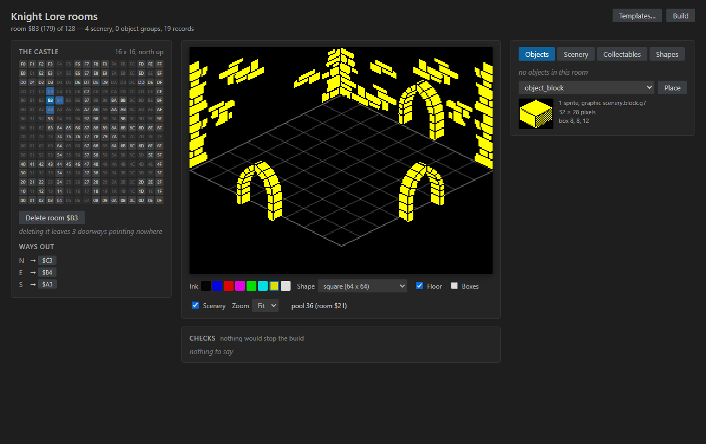
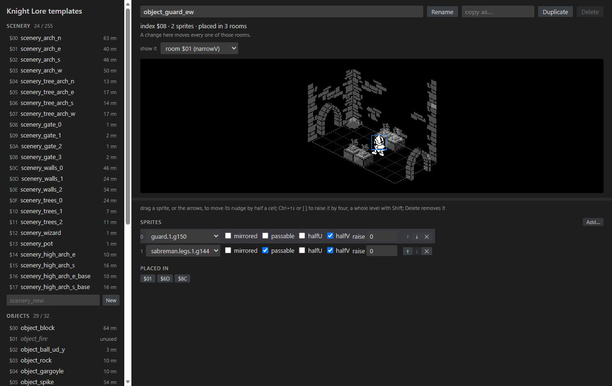
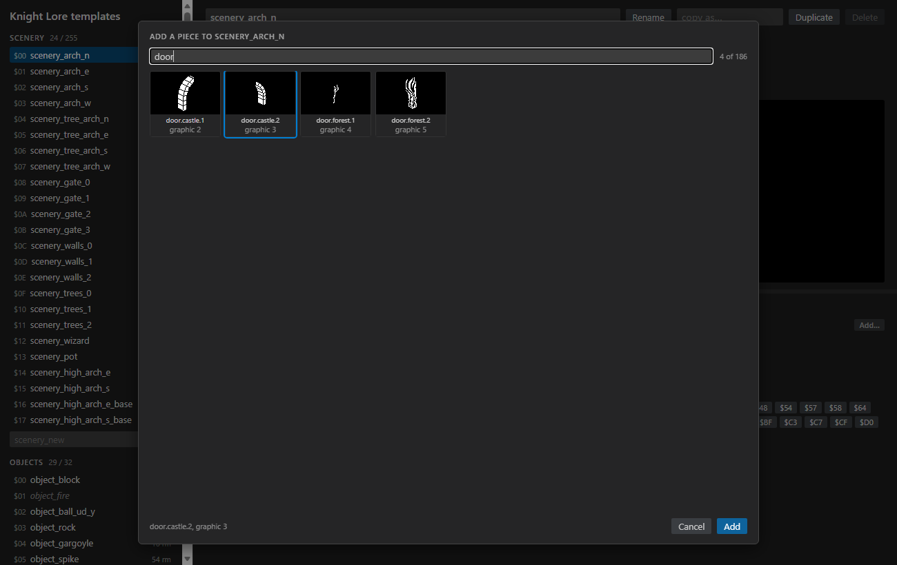
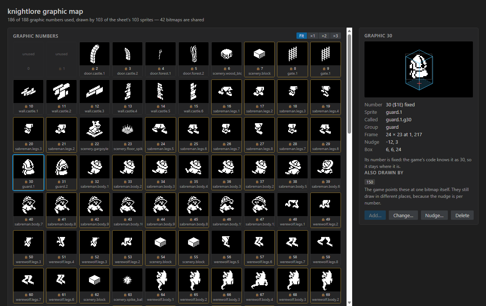
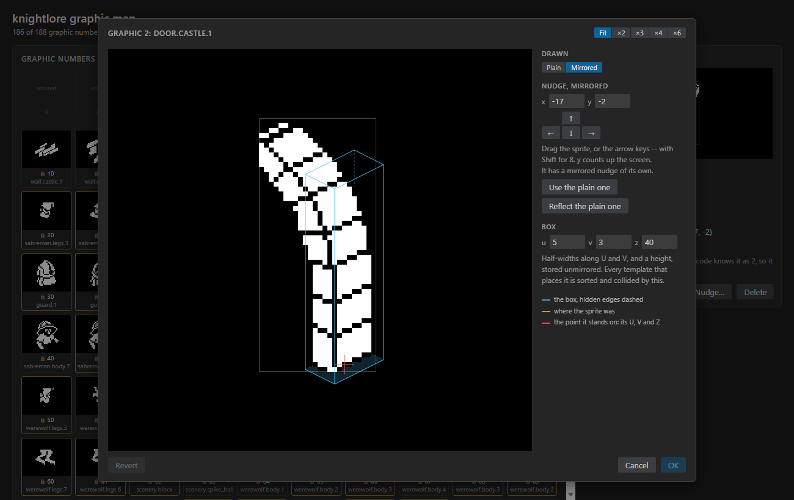
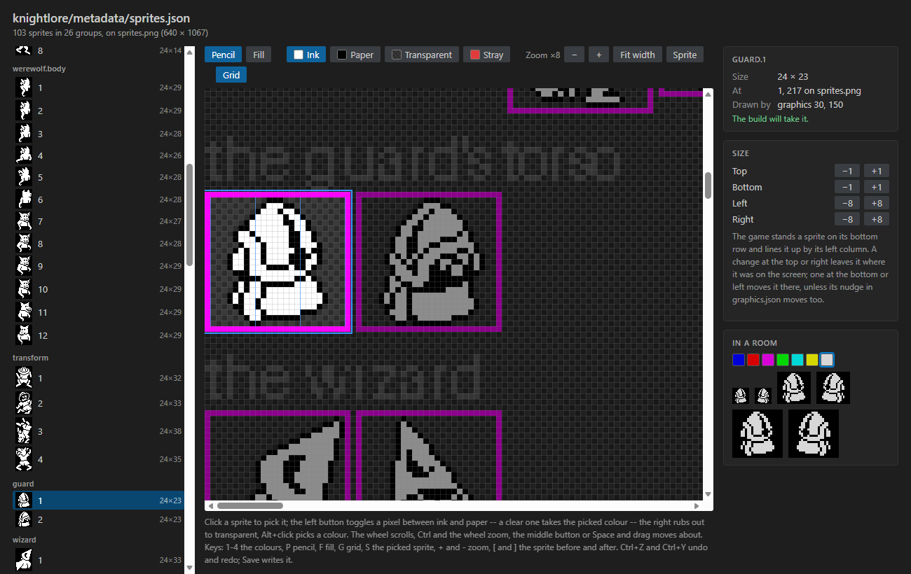

# Filmation Designer — user guide

Part of the [zx-spectrum-emulator README](../../README.md).

The Filmation Designer is a VS Code extension for editing the games in
`examples/filmation` -- the Knight Lore remake, Knight Lore 128K, Pentagram
and Lightkeep -- without editing their data files by hand. It has four
editors, one for each kind of file a game is built from:

| Editor | Opens | What you do there |
|---|---|---|
| [The room designer](#the-room-designer) | `metadata/rooms.json` | Lay out each room: its scenery, its objects, its floor, where its doorways lead |
| [The templates editor](#the-templates-editor) | `metadata/templates.json` | Change the pieces rooms are built from -- an arch, a guard, a row of spikes -- everywhere at once |
| [The graphic map](#the-graphic-map) | `metadata/graphics.json` | Say which sprite each graphic number draws, line it up with its box, and number it |
| [The sprite sheet editor](#the-sprite-sheet-editor) | `metadata/sprites.json`, `metadata/melkhior/*.json` | Draw the sprites themselves, size them and lay out the sheet |

This guide is organised by task. The full detail -- what every rule is and
why, and how each editor is held to what the engine does -- is in the
reference, [Designing a Filmation room](room-designer.md).

The screenshots show Knight Lore.

**Contents**

1. [Before you start](#before-you-start)
2. [Which editor for which job](#which-editor-for-which-job)
3. [The room designer](#the-room-designer)
4. [The templates editor](#the-templates-editor)
5. [The graphic map](#the-graphic-map)
6. [The sprite sheet editor](#the-sprite-sheet-editor)
7. [Seeing a change in the game](#seeing-a-change-in-the-game)
8. [Troubleshooting](#troubleshooting)

---

## Before you start

**Installing.** The designer is its own extension, in
`examples/filmation/vscode/`, separate from the emulator's. It has no build
step. Link its folder into VS Code's extensions folder, from the repository
root, and then run **Developer: Reload Window**:

```powershell
$dest = "$env:USERPROFILE\.vscode\extensions\jonsole.filmation-designer-0.0.1"
New-Item -ItemType Junction -Path $dest -Target (Resolve-Path .\examples\filmation\vscode)
```

Because it is linked rather than copied, an update to the repository takes
effect on the next **Reload Window**. A release also carries it as
`filmation-designer-<version>.vsix`, installed with **Extensions: Install
from VSIX...**.

**Opening an editor.** Open the file in the Explorer and its editor opens in
place of the text. Each also has a command in the Command Palette, which
offers the games it finds:

| Command | Editor |
|---|---|
| **Filmation: Design Rooms...** | The room designer |
| **Filmation: Edit Room Templates...** | The templates editor |
| **Filmation: Open Graphic Map...** | The graphic map |
| **Filmation: Edit Sprite Sheet...** | The sprite sheet editor |

To read or edit a file as text instead, right-click its tab and use
**Reopen Editor With... → Text Editor**. The schemas the extension installs
check the JSON as you type.

**Undo and Save are VS Code's own** in all four editors. Every change marks
the tab unsaved, **Ctrl+Z** and **Ctrl+Y** undo and redo it, and **Save**
writes the file. Nothing is written until you save.

**Where a game keeps its files.** Every game has the same layout:

```
examples/filmation/<game>/
  metadata/    rooms.json, templates.json, graphics.json, sprites.json -- what you edit
  art/         sprites.png -- the picture sprites.json describes
  output/      <game>.z80 -- what the build makes
  build.py     the build
```

Lightkeep also draws from Melkhior's Mansion's art. Its descriptions are in
`metadata/melkhior/` and are in the repository. Their pictures are in
`art/melkhior/` and are not: you convert them from your own copy of the game
with `lightkeep/scripts/melkhior_sheets.py`. Until you do, the editors list
those sprites but cannot draw them.

---

## Which editor for which job

A room is not a list of objects. It names **templates** -- castle-wide
pieces like "the north arch" or "a guard walking east-west" -- and each
template is a few **graphics** placed relative to each other. Each graphic is
a number the game knows, drawing one **sprite** from a sheet with a nudge to
line it up, inside a box the engine sorts and collides with.

| To... | Use |
|---|---|
| Move a block in one room, add a guard to a room, change a room's colour or doorways | [Room designer](#the-room-designer) |
| Change an arch, a wall or a monster in every room that has it | [Templates editor](#the-templates-editor) |
| Put a new sprite into the game, change which sprite a graphic draws, line a sprite up with its box, change a box's size | [Graphic map](#the-graphic-map) |
| Change a sprite's pixels or its size, or tidy a sheet | [Sprite sheet editor](#the-sprite-sheet-editor) |

The editors follow each other. A template changed in the templates editor,
saved or not, redraws in the room designer straight away. A graphic renamed or
renumbered in the graphic map is picked up by the rooms that use it.

---

## The room designer



The page has three columns:

- **The castle**, on the left: a map of the rooms. Knight Lore's room
  number is a place on a 16 by 16 grid, so its map is the castle, north at
  the top. Click a room to go to it. The rooms this one leads to are
  highlighted, and **Ways out** below says where each doorway goes.
- **The room**, in the middle, drawn as the game draws it, with the same
  depth order. Under it: the room's **ink**, its floor **shape**, a **zoom**,
  and switches for the floor grid, the objects' boxes, and the scenery.
  Turning scenery off is the quickest way to see what is behind the walls.
- **Objects**, **Scenery**, **Collectables** (Knight Lore) and **Shapes**, on
  the right, for the room on screen.

### Moving things in a room

Click an object to select it, and drag it about the floor. The floor under a
selected object is lit, with a dashed line up to it, so you can tell an
object high up from one far away. Two amber lines cross on the floor at its
place, one along U and one along V, across the room. The templates editor draws
the same lines. Anything in front of it is drawn faint, so it is never hidden.

| Key | Does |
|---|---|
| Arrows | Move the selected object a cell along the floor |
| **Ctrl+↑** / **Ctrl+↓**, or `]` / `[` | Raise or lower it a level |
| **Delete** | Remove it |

An object's position is the room's, but some templates carry a nudge of
half a cell or a raise. The side panel says so, and says how many rooms share
it. The nudge belongs to the template, not this room, so it is changed in the
templates editor.

### Adding to a room

On the **Objects** tab, pick a template and press **Place**: one goes in the
middle of the floor, to drag where you want it. The picture beside the picker
shows what it will place, its size, and its box. On the **Scenery** tab,
**Add** puts a scenery template in the room. Scenery carries its own place, so
the preview shows it where it will stand, such as a wall along the back.

### The room itself

- **Ink** and **Shape** are under the picture. A shape is shared by every
  room standing on it, so it is changed on the **Shapes** tab, which says how
  many rooms that is.
- **Ways out**, on the left, shows where each doorway leads. In Knight Lore
  the castle grid decides it. In Pentagram and Knight Lore 128K each is a
  number you can change, and **go** takes you there.
- **Adding a room.** On Knight Lore's grid, click an empty greyed square, then
  **Add room**. Elsewhere, **Add room** takes a number.
- **Deleting a room.** **Delete room** first says what it would leave
  pointing nowhere. It refuses the castle's last room and a starting room.
- **Starting rooms**, under the map, are where a game can begin. **Change**
  lets you click another room on the map to replace one. A room with
  something solid where the knight appears is refused, with the reason.

### Collectables (Knight Lore)

Knight Lore's thirty-two collectables live in `specials.json`, and the
**Collectables** tab edits them. They are drawn in the room they start in.
Which kind each one is gets dealt at random at the start of every game, so the
picture draws a stand-in you can cycle through. A room holds two at most, and
the panel says in red when a third would never appear.

### Checks

**Checks**, under the picture, lists anything that would stop the build or
stop the game building a room: a room out of order, an object off the floor,
a doorway to a room that is not there. A doorway with no way back is a
warning; it plays, but you cannot return through it. This room's problems
come first.

### Outside VS Code

The same page runs in a browser:

```powershell
python examples/filmation/vscode/room_designer.py               # Knight Lore
python examples/filmation/vscode/room_designer.py pentagram
```

There it has its own **Save**, **Undo** and **Redo**, and **Load** switches
game.

---

## The templates editor



Open `templates.json`, or press **Templates...** in the room designer's
header to open it in a window of its own, beside the designer or on another
screen.

On the left is every template, scenery then objects. Each shows its index,
how many rooms place it, and **code** if the game's source refers to it by
name. Pick one and it is drawn big.

**Show it** chooses what it is drawn in:

- on its own;
- on the floor of one of the castle's room shapes;
- in any room that places it, with the rest of the room dimmed.

A wall that looks right on its own can be half through a wall in a narrow
room, and this is where you see it. The bar under the picture resizes it.

### Moving a piece

Click a piece in the picture to select it, then:

| Do | Scenery | An object's piece |
|---|---|---|
| Drag | Moves it under the pointer | Moves its nudge |
| Arrows | A unit along the floor, eight with **Shift** | Switch its half-cell nudge on or off |
| **Ctrl+↑/↓**, `]` / `[` | Raise or lower a unit, eight with **Shift** | Raise or lower four, a level with **Shift** |
| **Delete** | Remove it | Remove it |

The selected piece is drawn with its box, the solid the game collides with,
in blue. Under it, the box's base is shaded on the floor with a white mark
under its middle, and a white line runs up from the mark to the piece when it
stands above the floor. A sprite high on the screen can be far back on the
floor or near and in the air; the mark and the line say which, while you drag
it as well. On a floor or in a room, two amber lines also cross on the floor at
the piece's place, one along U and one along V. They run across the room and on
out to the piece, so a piece standing outside the room, behind a back wall,
shows its lines leaving the floor. These marks are drawn over everything else,
so nothing in front of the piece hides them.

A piece whose sprite draws nothing, such as Lightkeep's invisible `solid`, is
always drawn as its box, in a fainter blue, and you click inside the box to
select it.

Lift a piece so high that it is off the top of the screen and it stays where
it is, above the rest, outlined in red, with a warning under the template's
name. The game works its screen position out in eight bits, so it would draw
that piece wrapped round to the bottom of the screen. The room designer shows
the game's screen, so it shows the wrap.

A piece too far back gets the same red outline, for a different reason. That
is a piece behind a room's far corner, with V − U of 128 or more. The game's
projection drops a bit there and draws the piece 128 rows lower than it
stands, and the warning says so.

Under the picture, every piece can be changed in place. You can change its
graphic, its U, V and Z (scenery), mirrored and passable, and its half-cell
nudges and raise (objects). **↑** and **↓** reorder the pieces, and **✕**
removes one.

### Adding a piece



**Add...** shows every graphic as a picture with its name and number. Type to
filter by name, click one, and press **Add**, or double-click it. The new
piece goes on the end of the template.

### New, duplicate, rename, delete

**New** (under each list) makes an empty template. **Duplicate** copies one
under a new name. **Rename** changes its name, and every room that names it is
renamed in the same edit.

A template's **position** in its list is the number the game knows it by,
and the game's code relies on some of those numbers. In Knight Lore, the first
eight scenery templates are the arches. So:

- a new or duplicated template always goes on the end;
- only the last one can be deleted, and only if no room uses it;
- a copy of a doorway is not a doorway, and a copy of a moving monster stands
  still, because the doorway and the movement come from the original's number
  and name;
- a template marked **code** can be renamed, but the build stops until the
  code is changed to match. The panel says which file.

### How an object moves (Lightkeep)

An object template has a **moves** row under its name: one of the game's
behaviours, read from its `movers.s`, or **doesn't move**. Each is marked if it
kills, or if it can be pushed. One that can be pushed has a **weight**, from 1
up: a push moves it the pusher's step less its weight, so the heavier it is,
the less it moves, and one as heavy as the push doesn't move at all. Pushed by
the knight, who walks 3 a turn:

| Weight | The object moves |
|---|---|
| 1 | 2 every turn |
| 2 | 1 every turn |
| 3 or more | not at all |

There is no weight 0. A push of the knight's whole step left a gap he spent
the next turn closing, so the object lurched 3 every other turn, slower on
average than one weighing 1.

This is saved in `templates.json` (`meta.movers`), and the build writes the
game's table from it. A rename, a copy or a delete takes it along. Knight
Lore, Knight Lore 128K and Pentagram still keep their tables in their code, so
they have no **moves** row.

A piece's **box** normally belongs to its graphic, and is changed with the
graphic map's **Nudge...**. A piece can have a box of its own instead: press
**own box** in its row, which starts from the graphic's, then type its three
sizes. U and V are half-widths and Z is the height, at most 127. **graphic's
box** goes back to the graphic's. An invisible box under artwork, like the
raised floor along Lightkeep's west wall (`scenery_raised_w`), is a `solid`
piece with a box of its own.

---

## The graphic map



Every graphic number is a tile showing what it draws:

- **Gold border:** more than one number draws that sprite.
- **Red border:** the file names a sprite that is not on any sheet.
- **Small lock:** the game's code relies on that number.

**Fit**, **×1**, **×2** and **×3** size the tiles. The fixed sizes keep
sprites true to one another.

Pick a number to see it in the side panel: its sprite stood in its 3D box,
its name, frame, nudge and box, and the other numbers that draw the same
bitmap.

- **Add...** puts a sprite into the game under an unused number. Choose the
  number, the sheet (Lightkeep also lists its Melkhior sheets), and the
  sprite. It is greyed out on a number that already has a sprite.
- **Change...** points the number at a different sprite. Double-clicking a
  tile does the same.
- **Delete** takes the sprite off the number. Its name and nudge stay.

### Lining a sprite up with its box



**Nudge...**, or a click on the picture in the side panel, shows the graphic
the way the game draws it. The sprite stands where its nudge puts it, inside
its box. The box is blue, with its hidden edges dashed. The red cross is the
point the graphic stands on.

- **Drag the sprite**, use the arrow buttons or keys (**Shift** for 8), or
  type the numbers. A gold outline marks where it started. **y counts up**
  the screen.
- **Plain** and **Mirrored** show it each way round. Most graphics use one
  nudge both ways. Moving the mirrored one gives it a nudge of its own, and
  **Use the plain one** takes that away. **Reflect the plain one** starts the
  mirrored nudge at the plain one's mirror image.
- **Box** -- U and V half-widths and a height -- can be changed beside it.
  Every template that places the graphic is sorted and collided by the box.
  **Give it a box** gives one to a graphic that has none.
- Nothing changes until **OK**, and then it is one undo.

### Renumbering a graphic

Drag a tile onto another number to move it there, or onto a used number to
swap the two. Rooms place graphics by name, so they follow.

A number with a lock can't be moved, and nothing can be swapped onto it. The
game's code relies on that number: an animation that adds to it, a constant,
a mover's arithmetic. Every graphic the original Knight Lore and Pentagram
came with is locked. A graphic you add yourself is not, until you mark it
`"fixed": true` in `graphics.json`.

---

## The sprite sheet editor



Open a game's `metadata/sprites.json`, or one of Lightkeep's
`metadata/melkhior/*.json`. The editor opens the picture it describes,
`art/sprites.png` or `art/melkhior/<name>.png`, and edits the two as one.

### Finding your way round

The middle is the whole sheet.

| Do | Does |
|---|---|
| Wheel | Scroll |
| **Ctrl**+wheel, **+** / **−** | Zoom, from ×1 to ×32 |
| Middle button drag, or **Space** and drag | Move about |
| **Fit width** | The whole width of the sheet |
| **Sprite**, or **S** | Zoom to the picked sprite and centre it |
| Click a sprite | Pick it |
| `[` / `]` | The sprite before or after |

The picked sprite has a blue ring, and the rest of the sheet is dimmed round
it. Zooming keeps it in view. On the left is the tree of groups with a
thumbnail of every sprite, and a filter. Picking one there brings it into
view.

### Drawing

Only the picked sprite can be painted, and painting never touches its frame.

- **The pencil**: a click on an **ink** pixel makes it **paper**, and a click
  on paper makes it ink. A clear pixel takes the colour picked in the
  toolbar. A drag keeps the colour its first pixel gave it.
- **Transparent** picked, or the **right button**, rubs out.
- **Fill** changes every joined pixel of one colour, by the same rule.
- **Alt**+click picks up the colour under the pointer.
- **Keys:** **1** to **4** pick ink, paper, transparent and stray. **P** is
  the pencil, **F** the fill, **G** the grid.

The colours are the build's: **ink** is drawn in the room's colour, **paper**
is black, and **transparent** shows what is behind. **Stray** is a data bit
under a hole in the mask, which shows nothing; a few original sprites have
it. The magenta frame round every sprite is how the build checks the
rectangles, and the editor keeps it.

Zoomed in, the grid shows every pixel, and stronger lines show the picked
sprite's **bytes**. The engine draws a sprite in whole bytes, eight pixels
wide.

The side panel says which graphics draw the sprite, and whether **the build
will take it**. If not, it says why: a broken frame, a colour with no
meaning, or a Melkhior sprite outside the engine's 16 to 40 pixels wide and
64 high. **In a room** previews it in any ink, at ×1 to ×3, both ways round.

### Sizing a sprite

The **Size** card grows or shrinks the picked sprite at one edge: a row at a
time at the top and bottom, a byte (8 columns) at the sides. The pixels
already drawn stay where they are, and new pixels are transparent.

The game stands a sprite on its bottom row and lines it up by its left
column. So:

- **Top** and **right** change the size and leave the sprite where it was on
  the screen.
- **Bottom** and **left** move it on the screen too, unless you also change
  its nudge in the graphic map.

A sprite that no longer fits where it is moves to the first free space on the
sheet, or the sheet grows at the bottom, and the card says where it went.

### Tidying a sheet

**Tidy sheet...**, at the top of the tree, lays every sprite out again in the
tree's order, each group from a new row. It asks first, because anything
else painted on the picture is lost, including the group names
`sprite_sheet.py` writes. Where a sprite sits on the sheet doesn't matter to
the game, so a tidied sheet builds the same game.

### Saving

A paint stroke, a fill, a resize and a tidy are each one undo. **Save** writes
the picture and, if a sprite moved or changed size, the description. The
description is written in the build's own layout, so a resize changes just
that sprite's line. If a paint program saves over the picture while nothing
is unsaved in the editor, the editor reloads it.

---

## Seeing a change in the game

1. **Save** in the editor.
2. **Build.** The room designer's **Build** button runs the game's
   `build.py` as a task, or run it yourself:

   ```powershell
   .venv-win\Scripts\python.exe examples\filmation\knightlore\build.py
   ```

   The build notices every file the editors write -- rooms, templates,
   graphics, sprites and their pictures, Lightkeep's Melkhior sheets included
   -- and rebuilds what depends on them.
3. **Run it.** The game's launch configuration builds and starts it in the
   emulator: **ZX Spectrum: Filmation** (Knight Lore), **ZX Spectrum: Knight
   Lore 128K**, or **ZX Spectrum: Lightkeep**. Or load `output/<game>.z80`
   into a running emulator.

See the [emulator's user guide](../../docs/vscode-user-guide.md) for running
and debugging.

---

## Troubleshooting

**An editor opens blank or black.** Run **Developer: Reload Window**. If it
stays blank, run **Developer: Open Webview Developer Tools** with the editor
showing and look in its console for the page's error. The editors' tests assemble every page the way
VS Code does and run it, so a blank page after a change to the extension
usually means the tests were not run.

**The extension does nothing after an update.** It is linked, not copied,
but VS Code reads it only when the window loads: **Reload Window**.

**"No picture here for ..." in the room designer, or Melkhior sprites
missing.** Lightkeep's Melkhior pictures are not in the repository. Convert
them from your copy of Melkhior's Mansion with
`lightkeep/scripts/melkhior_sheets.py`.

**The build stops on a sprite's frame or colour.** Open the sheet in the
sprite sheet editor and pick the sprite named in the message. The side panel
says what is wrong with it.

**A graphic won't move in the graphic map.** It has a lock: the game's code
uses its number. See [Renumbering a graphic](#renumbering-a-graphic).

**Save As on a sprite sheet is refused.** A sheet is two files, the
description and its picture, so it is saved where it is. Copy both files to
make another.

**Editing the JSON by hand.** Reopen the file with the text editor. The
editors write the files in the same layout the build's scripts write, so a
hand edit and an editor edit sit side by side in a diff.
