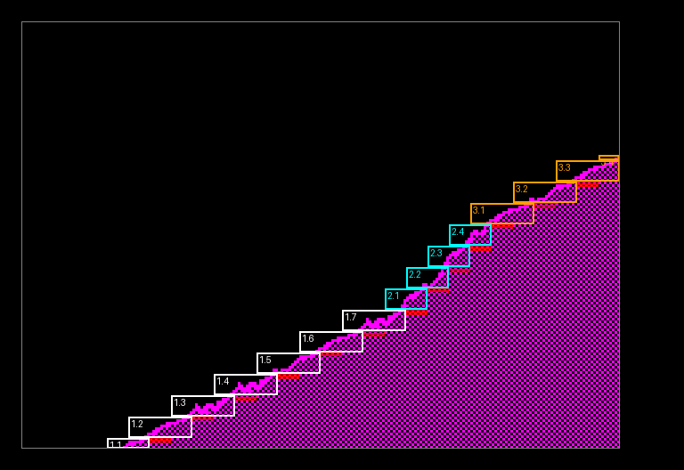

# How Jetrun's landscape is drawn

Jetrun's landscape is drawn by Ultimate's own renderer from Cyberun,
`cyberun.s`, made relocatable and sped up where marked `Jetrun:`
([ADR 0007](adr/0007-cyberuns-own-renderer-and-world.md)). This document
explains how it works as it stands, then follows one real pass through it.
The Cyberun disassembly's `notes/cyberun/landscape.md` in `game-disassemblies`
is the long account of the original; this one is about the code in this
directory, and every number in the worked example was traced from the built
game in SkoolKit's simulator.

## In one paragraph

Nothing is ever scrolled and the screen is never cleared. The world is a grid
of pages; a page holds a tile; a tile is up to seven pieces; a piece is a
straight run of identical steps (a flat run, a slope, a wall). Every pass,
the renderer works out which four pages the view overlaps, and for every
piece of those pages that can be seen draws every visible step straight onto
the screen with a POP blitter, from a graphic pre-shifted for the view's fine
position. Sky is black and rock is a checker of alternate pixels, and both
look the same after a move of 2 pixels, so most of the play area is already
right: the steps redraw the surfaces, and after each piece the strips its
moving edges uncovered are filled in. Then the cells along the piece are
coloured.

## The data

| Thing | What it is | Where |
|---|---|---|
| Map | 96 x 28 pages, a tile number each; row 0 above it is sky | `world_map` (from `world/map.json`) |
| Tile | a record: optional `$99` (upside down) and `$FF` (mirrored) markers, a count, then the pieces | `tile_table`, `tile_N` (from `world/tiles.json`) |
| Piece | x, y of its lowest step (page coordinates: 8 is the page's left edge, 24 its top), a byte of direction (high nibble) and steps (low; 0 is 16), and for a flat piece two end codes | in the tile record |
| Direction | one of sixteen: flat, gentle, 45 degrees, steep, each climbing right or left, the same seven as ceilings, and two walls | `piece_shapes`: run, column step, rise |
| Step graphic | nine stored shapes; the start-up made copies shifted by 2, 4 and 6 pixels (here they are data); each graphic holds three textured variants of its step, and the flat ones four end caps | `flat_piece_gfx` ... `slope_10_shifted`, between `graphics` and `graphics_end` |
| Variant | which of the three textures a step uses: step k of every piece uses `column_varieties[k]` | `column_varieties`, `graphic_offsets` |

The directions' shapes, from `piece_shapes`:

| Direction | Shape | Run (px) | Rise (rows) |
|---|---|---|---|
| 0 | flat floor | 24 | 0 |
| 1, 2, 3 | gentle, 45 degree, steep floor climbing right | 16, 8, 8 | 8, 8, 16 |
| 4, 5, 6 | the same, climbing left | -16, -8, -8 | 8, 8, 16 |
| 7-13 | 0-6 as ceilings: rock above, sky below | as 0-6 | |
| 14, 15 | wall, rock to the right / to the left | 0 | 16 |

## Coordinates: pages, origins and the window

Cyberun keeps the view as a map cell and two origins:

- `view_column`, `view_row`: the page holding the view's top-left (Jetrun's
  `cyberun_view` sets them from `view_x`, `view_y`).
- `origin_x`, `origin_y`: what turns a page point into a screen point. A
  piece step at page (x, y) is drawn at screen x = x + `origin_x`, y = y +
  `origin_y`, as 8-bit sums.
- `view_x` (= 8 - `origin_x`) is the page x at the play area's left edge;
  `view_y` (= $B7 - `origin_y`) is the lower page's y at its bottom line. The
  culling compares against these.

The view overlaps at most four pages, the window: the view's page, the one
below, the one right and the one below-right, `ground_cell` 0 to 3 in that
order. `draw_landscape` moves the origins for each: `origin_y` + $60 for the
upper pages and + $A0 (wrapping) for the lower, `origin_x` + $E0 for the
right-hand ones, so that the same sums work in every page.

`scroll_landscape` is given each pass's move in `scroll_across` and
`scroll_down` (2 or 4 pixels, signed: positive is the landscape moving right
or down, so the view moving the other way). It adds them to the origins,
takes them from `view_x` and `view_y`, and when an edge passes out of its
page moves the window a page and sets `record_ground`, which
`load_map_window` and `draw_landscape` take as "the window is new".

## A pass, top down

```
landscape_pass                        (landscape.s) the view's move since last pass
  cyberun_scroll -> scroll_landscape  move the origins; a page crossed: load_map_window
    set_landscape_colours             this window's two rock colours
    colour_this_pass                  Jetrun: can any piece's cells have changed?
    draw_landscape                    (JP: it returns to landscape_pass)
      assign_slots                    Jetrun, new window only: which slot holds each tile
      for each of the four pages:
        tile record: markers, count; empty -> next page
        for each piece:
          new to its slot? decode it (load_piece_steps, set_piece_shape, piece_ends),
                           record its collision box, keep both (keep_piece, keep_cull)
          otherwise:       cull it from the kept numbers; only if it can be seen,
                           restore the decoded state (Jetrun)
          cull: wholly left/right/above/below the view -> next piece
          for each step (landscape_step_loop):
            advance, cull the step, catch the exact-edge cases
            first drawn step: blitter and graphic from the shift table, screen address
            choose: flat -> flat_step_clip; slope near an edge -> clip decisions;
                    a slope's later step clear of everything -> fast path (Jetrun)
            draw_step: SP = graphic; trim rows below/above the play area
            JP (IY): the blitter draws it; HL is left where the next step starts
            after_step_drawn: count it, next step
          end of piece: SP back; flat run's lip; column fill (horizontal move);
                        row fills (vertical move); colour_piece
```

### Drawing a step

- **The graphic.** `origin_x` AND 7 picks one of four tables
  (`piece_blitters_shift0/2/4/6`, a blitter and a graphic for each direction):
  the steps of every piece are drawn at the same fine shift. The step's
  variant (from `column_varieties`) picks an offset into the graphic from
  `graphic_offsets`.
- **The blitter.** Entered with SP = the graphic, HL = the screen address
  less the step's byte advance, A = row pairs. Graphics are stored bottom row
  first, zig-zagging: the bottom row left to right, the row above right to
  left. Each POP fetches two bytes; the blitter writes them, steps sideways,
  moves up a line with `DEC H`, writes the next row back the other way, and
  moves up again, fixing the address up only after each row pair -- which is
  why every step's bottom line is odd. It ends `JP after_step_drawn` with HL
  where the next step of the piece starts, so consecutive steps need no
  address arithmetic.
- **Mirrors.** A step climbing left is its partner's graphic started one row
  later and drawn through `bit_reverse_table`; a shifted one uses the
  partner's opposite shift.
- **Clipping.** Never per byte. At the bottom and top `draw_step` pops the
  rows below the play area away or cuts the count; at the sides it patches a
  JR displacement (`draw_step_7`) to send the step to one of four clipping
  blitters, and `flat_step_clip` patches the flat blitter's own JRs.

### Why nothing is cleared, and what is filled

Sky (black) and the inside of rock ($55 on odd lines, $AA on even) are
unchanged by a move of 2 or 4 pixels, so only where a surface has moved can
the screen be wrong. The steps are redrawn every pass; what is left is the
strip a moving edge has uncovered:

- **Up or down** (`fill_behind_moving_piece`): the 2 or 4 rows just below each
  drawn step when the landscape moved up, above when it moved down, painted
  checker or black by the move's direction and whether the piece is a
  ceiling.
- **Across** (`fill_under_slope`, `fill_flat_end_column`): a shifted step is a
  byte wider than its run and covers its own old place, except when the fine
  position comes back to a byte boundary; then the column each step left is
  filled, and a flat run's dropping ends.
- **Caps and lips**: a flat run's end codes pick its first and last steps'
  graphics, a drop at that end, and a one-byte lip (`draw_flat_end_lip`).

### Colour

`colour_piece` colours, for each drawn step, a column of attribute cells one
to three wide, moving up by the rise; a flat piece three wide and about two
deep. The colour is the upper or lower page's (`map_row_colour`,
`map_row_colour_next`, from the map's colours by depth). Nothing else
colours the landscape: the play area was coloured once at power-on, and
Jetrun's astronaut saves and restores its own cells.

## What Jetrun changed

All in `cyberun.s`, all marked `Jetrun:`. The relocated renderer was first
checked against Cyberun's own code at its own addresses (4,132 passes of
random scrolling, every screen identical); each speed-up since was checked
against a build of the relocated renderer before any speed-up, over random
walks across Cyberun's world, every screen and attribute byte identical
after every pass. That comparison harness is a scratch tool, not yet in this
directory; `check.py` checks the game against its Python model, taking the
landscape from the Z80.

| Change | Why |
|---|---|
| Every address a label | runs wherever it is assembled |
| Its map and tiles, width `MAP_W`, empty tile below the map | Jetrun's world (for now Cyberun's own) |
| No fly-in, ground objects, beams, stars, ship | not Jetrun's |
| `draw_landscape` keeps its own SP (`landscape_sp`) | Cyberun reloaded a fixed `stack_top`, so it had to be called at one stack depth |
| Interrupts left on | the blitters borrow SP; `isr` in `jetrun.s` mends the two graphic bytes its push lands on, from `graphics_copy` |
| `fill_up_past_step` sets HL from its row | it walked up two lines at a time with `line_up_hl`: a third of a busy pass |
| `fill_under_slope` has `line_up_hl` written in | no CALL a row pair |
| `colour_this_pass` | colouring skipped when no piece's cells can have changed (no move up or down, no new byte column, window unchanged) |
| Colour and fill fast paths | a column or strip wholly inside the play area is written without testing every cell |
| Slots: `assign_slots`, `keep_piece`, `keep_cull` | a piece's decode depends only on its tile: done once when the tile enters one of four slots, then restored |
| Cull first (`draw_landscape_cached`) | a cached piece is culled from four kept numbers before anything is restored |
| `landscape_step_loop_fast` | a slope's later steps advance and check against the piece's constants, patched in by `patch_fast_step`, and go straight to the blitter |

## Worked example: pass 300 of the journey

`check.py`'s journey walks the astronaut right from the start of Cyberun's
world. At its 300th pass the astronaut is climbing the first hill and the
view moves 2 pixels right and 2 down. The picture is the play area after
this pass's landscape, 3 times size: each step drawn is boxed and numbered
piece.step, and the bytes the vertical fill painted are marked red.



### The move and the window

`landscape_pass` finds the view moved +2 across and +2 down since the last
pass, so `scroll_across` = -2 and `scroll_down` = -2.

| | Before `scroll_landscape` | After |
|---|---|---|
| `origin_x`, `origin_y` | 208, 14 | 206, 12 |
| `view_x`, `view_y` | 56, 169 | 58, 171 |
| window (`view_column`, `view_row`) | 1, 9 | 1, 9: no page crossed, `record_ground` 0 |

So the window is map row 9 and 10 (Cyberun's numbering; Jetrun's rows 8 and
9), columns 1 and 2:

| `ground_cell` | Page | Tile | Origins for it | |
|---|---|---|---|---|
| 0, upper left | (1, 9) | `t00` | 206, 108 | empty: sky |
| 1, lower left | (1, 10) | `t03` | 206, 12 | two pieces |
| 2, upper right | (2, 9) | `t00` | 174, 108 | empty |
| 3, lower right | (2, 10) | `t04` | 174, 12 | three pieces |

The shift is 206 AND 7 = 6, so every step this pass is drawn from the
6-pixel copies. Colour: the view moved down, so `colour_this_pass` sets
`colour_now` and every drawn piece is coloured. The window is not new, so
every tile is already in its slot: nothing is decoded.

### The pieces

| Piece | Tile | Record: start, direction, steps | Kept cull numbers (right, left, top, bottom) | Result |
|---|---|---|---|---|
| 1 | `t03` | (72, 183), 1 gentle right, 8 | | 7 of 8 steps drawn |
| 2 | `t03` | (200, 119), 2 45 degrees right, 4 | | all 4 drawn |
| - | `t04` | (72, 55), 0 flat, 4 | (168, 72, 55, 51) | culled: a right-hand page's piece whose left end, 72, is right of `view_x`, 58 |
| 3 | `t04` | (8, 87), 1 gentle right, 4 | | all 4 drawn, the last clipped |
| - | `t04` | (168, 55), 1 gentle right, 4 | (232, 168, 55, 23) | culled: left end 168 > 58 |

The two culled pieces cost a comparison each and a jump to the next piece;
nothing of theirs is restored.

### Piece 1, step by step

Gentle steps climb 8 rows for 16 pixels; at shift 6 the blitter is
`blit_three` (three bytes a row) and the graphic `slope_1_shifted`, whose
6-pixel copy begins at +186; the variants are at +0, +27, +54 from there.
Screen x = page x + 206, y = page y + 12, as 8-bit sums.

| Step | Page (x, y) | Screen (x, y) | Path | What happens | Variant, graphic | HL | Bytes changed |
|---|---|---|---|---|---|---|---|
| 1 | 72, 183 | 22, 195 | full | culled: its top, 183 - 8 = 175, is below `view_y` 171 | | | 0 |
| 2 | 88, 175 | 38, 187 | full | the piece's first drawn step: the blitter and graphic from the shift-6 table, `step_screen_address`. It hangs below the play area (bottom line 183): `draw_step` pops 4 rows of the graphic away and draws 2 row pairs | 1, +225 (= +213 + 12 popped) | $57C2 | 6 |
| 3 | 104, 167 | 54, 179 | fast | `patch_fast_step` has patched the piece's rise 8, run 16 and the view's edges into the fast path; every test passes | 0, +186 | $53C4 | 14 |
| 4 | 120, 159 | 70, 171 | fast | | 2, +240 | $53A6 | 15 |
| 5 | 136, 151 | 86, 163 | fast | | 2, +240 | $5388 | 15 |
| 6 | 152, 143 | 102, 155 | fast | | 1, +213 | $536A | 14 |
| 7 | 168, 135 | 118, 147 | fast | | 0, +186 | $534C | 14 |
| 8 | 184, 127 | 134, 139 | fast | | 2, +240 | $532E | 15 |

HL is each blitter's own leaving: from $53C4 to $53A6 is one character row
up ($20 less) and two bytes right, the step's 8 rows and 16 pixels. (The
bytes-changed column counts only bytes whose value changed: a step redrawn
where the same step was last pass rewrites most of its bytes with what they
already held.)

Then the end of piece 1:

- no lip (a slope has no end codes);
- no column fill: the fine position (6) is not on a byte boundary;
- the row fill: the landscape moved up 2, so the 2 rows under each drawn step
  are painted with the checker -- 12 bytes change, the red marks under the
  white boxes;
- `colour_piece` colours a column of cells three wide (the step's two-byte
  column step plus one) for each step, bright magenta ($43, the surface's
  colour). Every one of those cells already held it, so
  no attribute changes this pass -- the cells only change when a step moves
  into new ones.

### Pieces 2 and 3

Piece 2 (cyan) is the hill's 45-degree climb: at shift 6 `blit_two` (two bytes
a row) and `slope_2_shifted`. Its first step takes the full path, the other
three the fast one.

Piece 3 (orange) is in the lower-right page, `origin_x` 174. Its first step
takes the full path and its second the fast one. Its third, at screen x 214,
fails the fast path's right-edge test (x from $D1 is Cyberun's to decide), so
it goes the full way: `slope_step_at_right_edge` finds its far side, 230, still
inside $E9 and draws it whole. Its fourth, at x 230, crosses the right edge:
the dispatch JR is patched to 2, and `blit_right_clip` draws only its first
column, the play area's last; 2 bytes change.

### What it cost

The whole `landscape_pass`: 54,119 T-states, just over three quarters of a
frame. By family:

| | T-states | |
|---|---|---|
| Steps: advance, cull, choose the path, set up the blitter | 16,590 | 31% |
| Colouring | 10,748 | 20% |
| Fills | 9,285 | 17% |
| Blitting | 8,062 | 15% |
| Pieces: restore, cull | 7,793 | 14% |
| Scroll and window | 1,535 | 3% |

Fifteen steps drawn, about 3,600 T-states each all told, of which the blit
itself is about 540: most of the time is the deciding, the colouring and the
filling around it. That is where any further speed-up has to come from.
